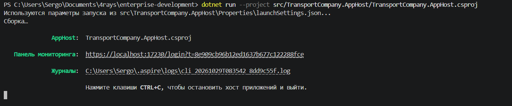
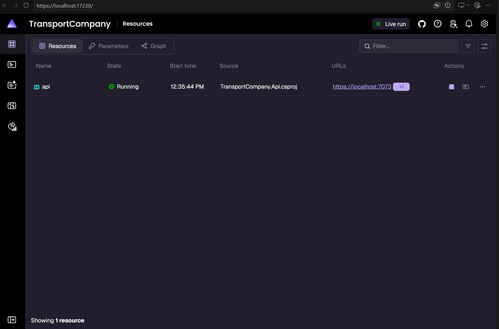
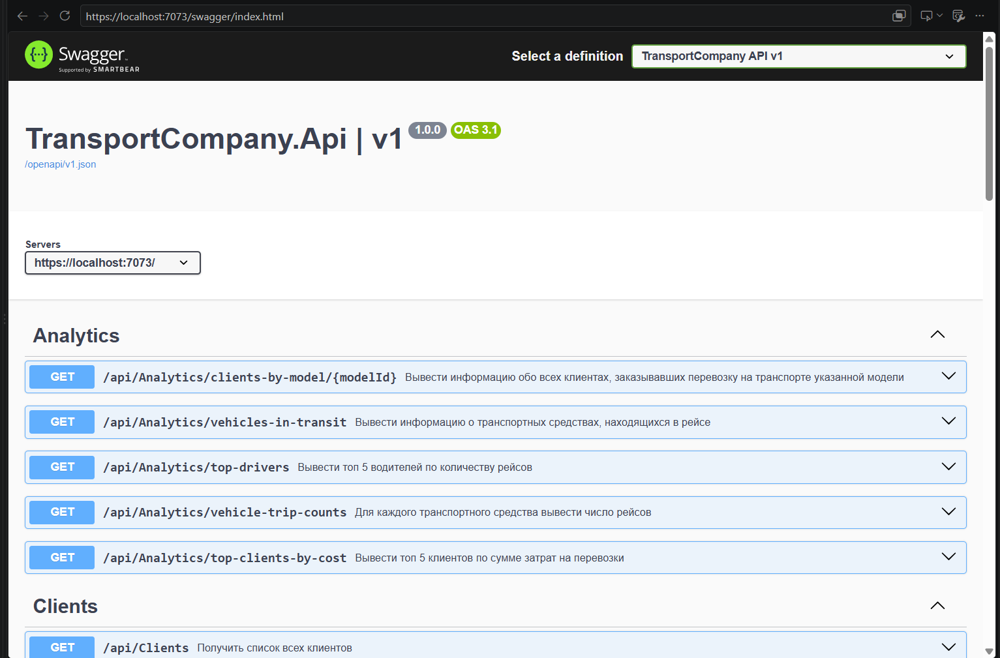
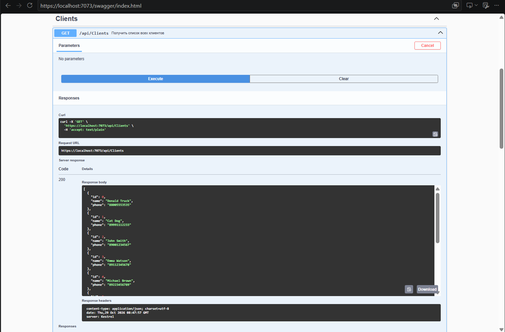
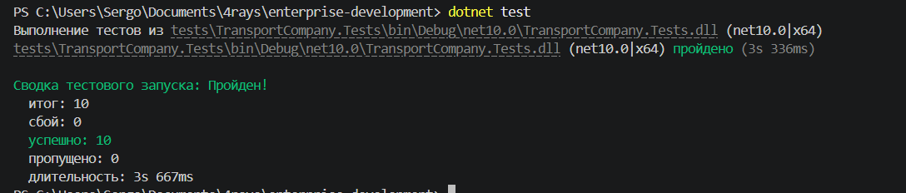

# Разработка корпоративных приложений

## Лабораторная 2. «Сервер» - Реализация серверного приложения с использованием REST API
Во второй лабораторной работе необходимо реализовать серверное приложение, которое должно: - Осуществлять базовые CRUD-операции с реализованными в первой лабораторной сущностями - Предоставлять результаты аналитических запросов (раздел «Unit-тесты» задания)
Хранение данных на этом этапе допускается осуществлять в памяти в виде коллекций

### Запуск
```bash
dotnet run --project src/TransportCompany.AppHost/TransportCompany.AppHost.csproj

# либо

dotnet test
```

### Результаты
Запуск Aspire

Панель Aspire

Панель Swagger

Пример работы одной ручки

Прохождение тестов
